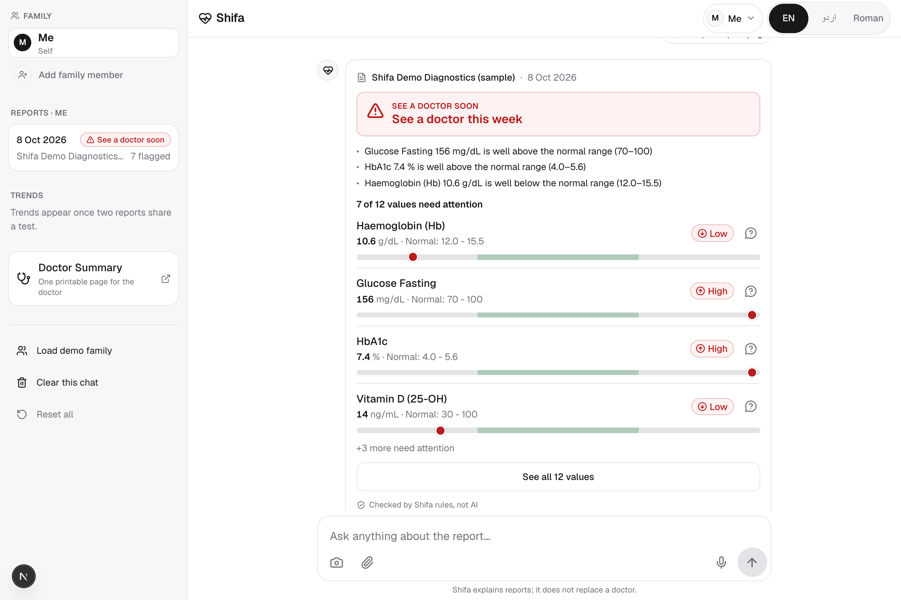
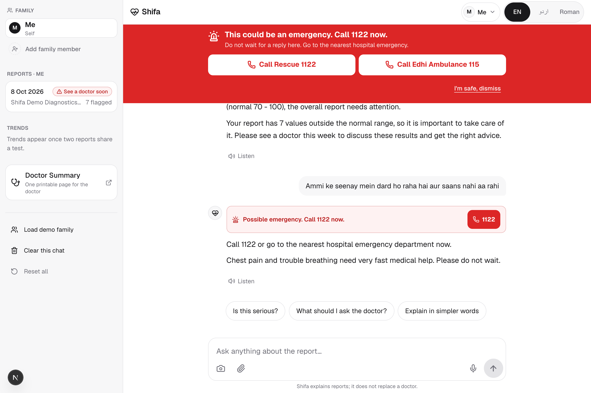
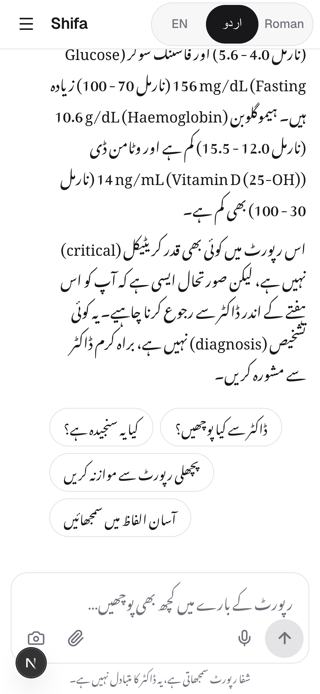

# Shifa: lab reports, explained in your language

**Shifa** is a chat-first assistant for Pakistani families. You send a photo of a lab report, and Shifa:
- **reads it** (AI)
- **checks every value** against the report's own normal ranges and a list of danger values (plain code, no AI)
- **says how urgent it is**
- **explains it in English, Urdu or Roman Urdu**, then answers your follow-up questions

> Built for the AIEF 4th International AI Championship, category **AI in Healthcare**.
> Live demo: TODO · Video (2 min): TODO

| Report card (checked by code) | Emergency detection | Urdu (mobile) |
|---|---|---|
|  |  |  |

## Why it is not "just a chatbot"

| Step | Who does it | Why |
|---|---|---|
| Read the report (photo/PDF → structured values) | Gemini vision | AI is good at messy documents |
| Flag each value low/high, detect danger values, set urgency | `src/lib/labRules.ts` (deterministic code) | Numbers and safety thresholds must never be guessed |
| Show the report card | Code | What you see was checked, not generated |
| Explain, answer questions, Urdu/Roman Urdu | Gemini (streaming), grounded only in this person's reports | AI is good at kind, simple language |
| Detect emergencies ("seenay mein dard", "saans nahi aa rahi") | Keyword + fuzzy matching in code **and** an AI flag | Either one shows a red banner with **1122** and **Edhi 115** |

The AI is told the flags were computed by code and must never override them.

**Reading accuracy on real reports:** TODO, run `npm run eval` (see `eval/README.md`).

## Features
- **Scan in chat:** camera or attach (photo or PDF).
  1. Progress: *Reading → Checking → Explaining*.
  2. A verified report card appears, with an urgency level and range bars.
  3. A streamed explanation follows.
- **Urgency levels:** Emergency now · See a doctor this week · Mention at next visit · Normal.
- **Follow-up chips:** "Kya ye serious hai?", "Doctor se kya poochein?", "Compare with last report".
- **Family profiles:** Ammi, Abbu, Me. Each person keeps their own reports and chat.
- **Trends:** the same test across reports, charted against its normal band.
- **Doctor Summary:** a printable one-page summary with questions to ask.
- **Voice in and out** (best effort, using the browser's built-in speech).
- **Backup / Restore:** save everything to a `.json` file and restore it on any phone. Restoring merges with what's already there and never overwrites. This covers cleared browsers, new phones, and iPhone Safari's 7-day storage limit, all without an account.
- **Privacy:** optional Google sign-in, with a private space per account on the device. Reports stay in your browser, and images are never stored.

## Run it locally
```bash
npm install
cp .env.example .env.local   # add your GEMINI_API_KEY (free at aistudio.google.com)
npm run dev                  # http://localhost:3000
```
Without a key, the app still runs in offline demo mode: "Try a sample report" and "Load demo family" work.

| Env var | Purpose |
|---|---|
| `GEMINI_API_KEY` | Google Gemini API key (server-side only) |
| `GEMINI_MODEL` | Ordered, comma-separated fallback chain, e.g. `gemini-3.5-flash,gemini-flash-lite-latest` |
| `SHIFA_ACCESS_CODE` | Optional passcode to protect a public demo's quota |
| `GOOGLE_CLIENT_ID`, `GOOGLE_CLIENT_SECRET` | Optional Google sign-in (OAuth client, Web application). Leave empty for guest-only mode |
| `NEXTAUTH_SECRET` | Random secret for sign-in sessions (`openssl rand -base64 32`) |
| `NEXTAUTH_URL` | Local only: `http://localhost:3000`. Leave unset on Vercel |
| `SHIFA_REQUIRE_SIGNIN` | `true` = everyone must sign in before using the AI; `false` (default) = guests allowed |

**Google sign-in:**
- **What it gives you:** each Google account gets its own private space on the device, so a shared family phone keeps everyone's reports separate. Signing out hides them.
- **No cloud upload:** reports are still never uploaded.
- **Redirect URIs:** `http://localhost:3000/api/auth/callback/google` and `https://<your-app>.vercel.app/api/auth/callback/google`.
- **Where it works:** Google only allows sign-in on https or localhost, so it won't work over a LAN IP like `http://192.168.x.x:3000`.

## Scripts
| Command | What it does |
|---|---|
| `npm run selftest` | Rule-engine and safety tests: flags, danger values, urgency, trends, emergency phrases, upload checks |
| `npm run eval` | Reading-accuracy evaluation on hand-labelled real reports (needs `npm run dev` running) |
| `npm run models` | Lists the Gemini models your key can use |
| `npx tsx scripts/smoke-api.ts` | Live end-to-end API check: sample report → checks → streamed explanation, follow-up, emergency, safety refusal (needs `npm run dev`) |
| `node scripts/screens.mjs` | Drives the app in Chrome, checks for page errors, and refreshes `docs/screenshots/` (needs `npm run dev`) |
| `npm run build` | Production build |

## Architecture
```
Phone browser (Next.js client)                 Server (Next.js API routes)            Google Gemini
─────────────────────────────                  ───────────────────────────           ─────────────
photo/PDF ─ shrink on device ──────────────▶  /api/extract  (guard: rate limit,  ──▶ vision → JSON
                                               same-origin, upload checks)
labRules.checkReport()  ◀── ExtractedReport ──┘
  flags · danger values · urgency (no AI)
report card + localStorage
question / "explain" ──────────────────────▶  /api/chat (grounded prompt,        ──▶ streaming text
emergency detector (client) ◀── text stream ──  emergency sentinel, offline fallback)
```
- **Stack:** Next.js 15 · React 19 · TypeScript · Tailwind CSS v4 · Gemini REST API · fuse.js · recharts
- **Security:** see `SECURITY.md`.

## Deploy (Vercel)
1. Push to GitHub and import the repo in Vercel.
2. Add `GEMINI_API_KEY` (and optionally `GEMINI_MODEL`, `SHIFA_ACCESS_CODE`) in Project → Settings → Environment Variables.
3. Deploy.

## Roadmap (Phase 2)
- **Medicines:** scan a strip, box or prescription. The reading is matched against a verified database of Pakistani brands.
- **Medicine safety checks:** catch the same ingredient twice (Panadol + Panadol Extra) and doses over the daily maximum.
- **Dose schedules:** turn "1+0+1 × 5 din" into reminders (Calendar / WhatsApp).
- **Clinical review:** a clinician reviews the danger-value list and the explanation tone.

## Disclaimer
Shifa explains lab reports to help families understand them. It does not diagnose, prescribe, or replace a doctor. In an emergency, call **1122**.

## Team
TODO: names, university.
